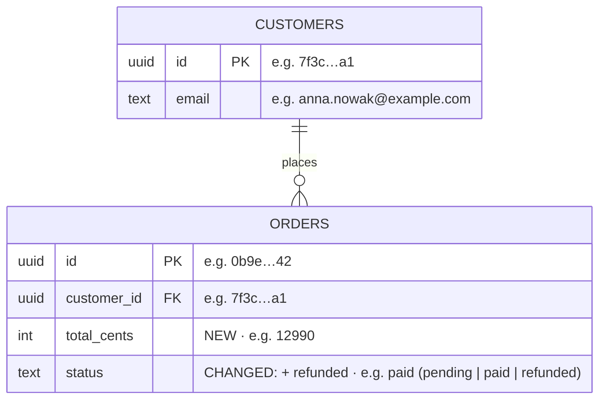

# diffboard

`diffboard` is a local server that watches git repositories and draws the branch's changed files as
a graph with diffs, line references and notes. It reads git, so you never push content to it: edit
files and commit as usual and the board follows. Source: https://github.com/teceer/diffboard.

**Local conventions:** if `~/.diffboard/skill.local.md` exists, read it before your first
diffboard command; it holds the user's own rules (base branches, board names, how to open the
board) and they take precedence over the defaults here.

## Boards: one per session

One server holds several independent boards, listed in the board's left sidebar. Each has its
own repos, diff mode, notes, tours and review marks. **Work on your own board, never on `default`
or another session's board**: adding or removing repos there changes what other agents and the
user see.

## When you start implementing

1. Create a board for your task with every repository you will change (name it after the task or
   ticket, e.g. `PROJ-142 checkout redesign`):
   ```bash
   diffboard board new "<task name>" <repo-path> [<repo-path>...] [--base <target branch>]
   # prints the board id and its url; starts the server when it is not running
   ```
   If a board for this task already exists (`diffboard board list`), reuse it:
   `diffboard add <repo-path> --board <id>`.
2. Commands pick the board in this order: `--board <id>`, `$DIFFBOARD_BOARD`, the board that
   watches the current directory, `default`. Inside your repo you can usually omit `--board`;
   when one repo sits on several boards, pass `--board <id>` (prefix shell calls with
   `DIFFBOARD_BOARD=<id>` to be safe). `diffboard board current` shows which board applies here.
   When auto picks the wrong base, set the branch your work targets:
   `diffboard base <repo-id> origin/<target-branch> --board <id>`.
3. Tell the user the board url once (`diffboard url --board <id>`, it carries `#board=<id>`).
4. Commit in small, logical steps. The board's "since last commit" mode then shows exactly what you
   are doing right now.

## Notes and diagrams

Explain non-obvious decisions where they live, not only in chat:

```bash
DIFFBOARD_AUTHOR=agent:claude diffboard note add --title "<short title>" \
  --link <repo-id>:<path>[:start-end] [--link ...] --body-file /tmp/note.md
```

- Bodies are Markdown; diagrams go in ```` ```mermaid ```` fences.
- Mermaid is strict: no empty link labels (`A -.-> B`, not `A -. .-> B`), quote labels with
  special characters (`A["status: paid (v2)"]`). The board shows a broken diagram as an error box
  with the parser message: open the note's link once after writing it and fix what it reports.
- Link every file the note is about (many-to-many). Line ranges are welcome.
- Update instead of duplicating: `diffboard note list`, then `diffboard note edit <id> --body-file ... --link ...`.
- Keep notes short and factual; they are review aids, not documentation.

### Database schema changes: always add a diagram

Whenever you add or change the database schema (new tables or columns, changed types, relations,
indexes, constraints; entity/ORM schema files, migrations, SQL), add a note with an ER diagram of
the affected part, or update the existing one (`diffboard note list`), in the same step as the change:

- A ```` ```mermaid ```` `erDiagram` with the touched tables and their direct neighbours only: the
  columns that matter (keys, foreign keys, new and changed columns, with types), and relations with
  cardinality. Mark what is new or changed, e.g. a `"NEW"` / `"CHANGED"` comment on the column.
- **Always give example values.** Every column shown in the diagram gets a realistic sample value
  in its comment (`e.g. …`), after the NEW/CHANGED marker. Below the diagram, add a small Markdown
  table of sample rows for each new or changed table (2-3 rows), with foreign keys that point at the
  sample rows of the related tables, so the reader sees how the records connect. Use values that
  look like the domain (real-looking names, enum values, JSON shapes), never `foo`/`bar`.
- Title it `DB: <area>` and link the schema files and the migration (`--link` each).
- Under the samples, a few lines: what changed and why, migration and backfill concerns, and
  anything the reviewer should check (nullability, defaults, index usage, data loss).



| ORDERS.id | customer_id | total_cents | status |
|---|---|---|---|
| 0b9e…42 | 7f3c…a1 (anna.nowak@…) | 12990 | paid |
| 5d21…07 | 7f3c…a1 (anna.nowak@…) | 4500 | refunded |

## Review tour

When a chunk of work is ready for the user to read, save a guided order through it. Steps go
bottom-up: what everything else builds on first (shared libraries, migrations, entities), then
domain, repositories, services, controllers, UI. Each note says what to look at and why, in one
or two sentences. Point at line ranges when only part of a file matters.

```bash
DIFFBOARD_AUTHOR=agent:claude diffboard tour set <task-id> \
  --step "<repo-id>:<path>[:start-end] | <what to look at>" \
  --step "..."                       # or --steps-file steps.txt, one "<ref> | <note>" per line
diffboard tour list | show <name> | rm <name>
```

`tour set` replaces the whole tour, so rerun it with the full list after more commits. Give the
user the printed `http://localhost:4700/#board=<id>&tour=<name>` link. Files left out of the tour still show
below it in the automatic order (imports first), so the tour only needs the files worth explaining.

## References from the user

The user copies references from the board and pastes them into chat:

- `/abs/path/file.ts:12-30` → read those lines of the working-tree file.
- `/abs/path/file.ts:12-30 (at base <sha>)` → the old side: `git show <sha>:<path>` and read those lines.
- `http://localhost:4700/#board=<b>&file=<repo>:<path>&lines=12-30&side=new` → same as the first
  form; the repo path is in `diffboard status --board <b>`. No `board=` means `default`.
- `http://localhost:4700/#board=<b>&note=<id>` → `diffboard note show <id> --board <b>`.
- `…&tour=<name>` → the user is following that tour; `diffboard tour show <name>`.

## Housekeeping

- When the task is finished (merged), archive your board: `diffboard board rm <id>` (notes and
  tours move to `~/.diffboard/archive`). `diffboard remove <repo-id> --board <id>` drops one repo.
- Logs: `~/.diffboard/server.log`. Restart: `diffboard stop && diffboard start` (boards persist in
  `~/.diffboard/boards/`). A server older than boards answers `no board …`/404 on `/api/b/…`:
  restart it.
